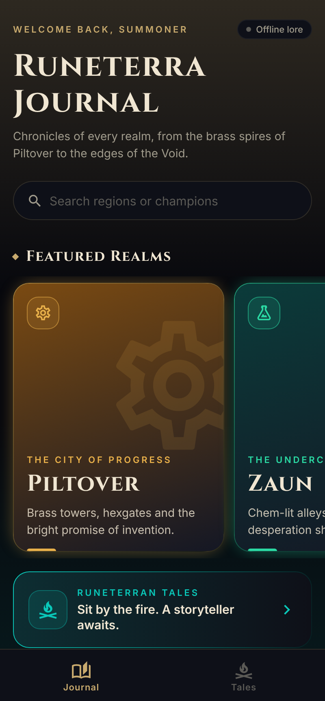
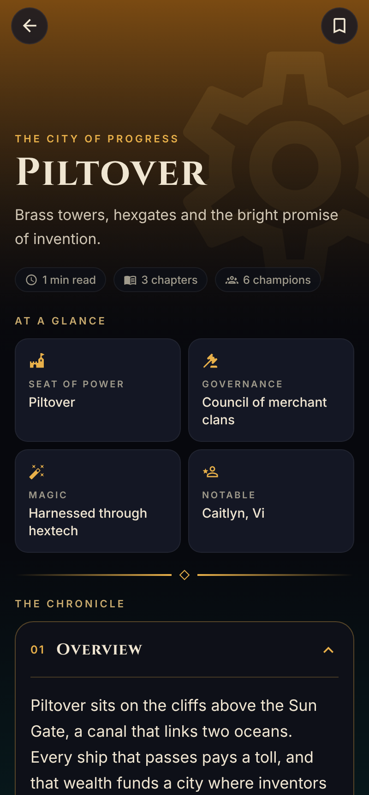
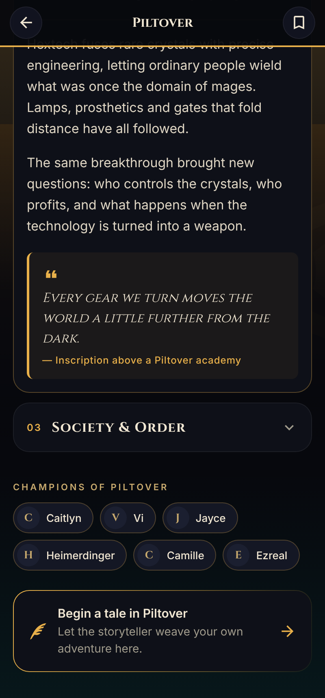
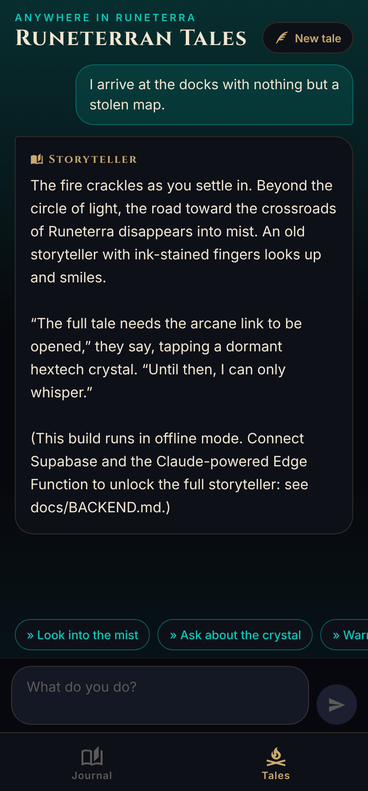

# Runeterra Journal

A dark-mode lore journal for League of Legends fans, built with **React Native + Expo (SDK 54)** and **Expo Router**.
It has a region dashboard, a Lore Reader with collapsible chapters, and **Runeterran Tales**, an interactive storyteller
powered by Claude through a Supabase Edge Function.

| Dashboard | Lore Reader | Lore Reader (chapters) | Runeterran Tales |
|---|---|---|---|
|  |  |  |  |

## Download the APK

Every push builds an Android APK on GitHub Actions (`.github/workflows/android-apk.yml`):

- **Releases** (right side of the repo page) → newest `apk-v…` pre-release → download the `.apk`
- or **Actions → Android APK → latest run → Artifacts → `runeterra-journal-apk`**

On your phone, open the `.apk` and allow "Install unknown apps" when prompted.
Without backend secrets the APK runs in **offline mode**: all lore is bundled, and the storyteller replies with a demo message.

## Project structure

```
.
├── app/                          # Expo Router: file-based routes
│   ├── _layout.tsx               # Root stack, fonts (Cinzel + Inter), dark nav theme, providers
│   ├── (tabs)/
│   │   ├── _layout.tsx           # Bottom tabs: Journal / Tales
│   │   ├── index.tsx             # Dashboard: featured carousel, search, saved, region grid
│   │   └── tales.tsx             # Runeterran Tales: AI storyteller chat
│   └── region/
│       └── [id].tsx              # Lore Reader: parallax hero, facts, collapsible chapters
├── src/
│   ├── components/               # Reusable UI
│   │   ├── CollapsibleSection.tsx  # Animated accordion (Reanimated layout transitions)
│   │   ├── FactTile.tsx
│   │   ├── GlowCard.tsx            # Gradient-border card
│   │   ├── Ornament.tsx            # Gold divider
│   │   ├── PressableScale.tsx      # Spring press + haptics
│   │   ├── RegionCard.tsx          # Featured + grid region cards
│   │   └── ScreenBackground.tsx    # Dark backdrop with accent glows
│   ├── data/
│   │   ├── regions.ts            # Bundled lore (offline + seed source)
│   │   └── types.ts              # Region / LoreSection types + DB row mapping
│   ├── hooks/
│   │   ├── useBookmarks.ts       # Persisted bookmarks (AsyncStorage)
│   │   └── useRegions.ts         # Supabase → fallback to bundled lore
│   ├── lib/
│   │   ├── storyteller.ts        # Calls the Edge Function, parses suggestions, saves tales
│   │   └── supabase.ts           # Supabase client + anonymous session
│   └── theme/tokens.ts           # Colours, spacing, radii, typography, glow
├── supabase/
│   ├── migrations/               # Schema + RLS, generated region seed
│   └── functions/storyteller/    # Deno Edge Function → Claude API
├── scripts/generate-seed.mjs     # regions.ts → SQL seed
├── docs/BACKEND.md               # Supabase + Claude setup guide
└── .github/workflows/android-apk.yml
```

## Run locally

```bash
npm install
cp .env.example .env           # optional: Supabase URL + anon key
npx expo start                 # press "a" for an Android emulator/device, or scan with Expo Go
```

Lore and the dashboard work in Expo Go. For the closest match to the APK, use a development build: `npx expo run:android`.

## Connect the backend (Supabase + Claude)

See **[docs/BACKEND.md](docs/BACKEND.md)**. Short version:

```bash
supabase link --project-ref <ref>
supabase db push                                   # tables, RLS, seed lore
supabase secrets set ANTHROPIC_API_KEY=sk-ant-...  # key stays server-side
supabase functions deploy storyteller
```

Then set `EXPO_PUBLIC_SUPABASE_URL` / `EXPO_PUBLIC_SUPABASE_ANON_KEY` in `.env` (local) or as GitHub repository secrets (CI APK builds).

## Build the APK yourself

**Option A: local Gradle** (needs Android Studio / SDK + JDK 17)

```bash
npm run apk
# → android/app/build/outputs/apk/release/app-release.apk
```

**Option B: EAS Build** (Expo's cloud; no Android SDK needed)

```bash
npm i -g eas-cli && eas login
eas build:configure
# In eas.json set:  "preview": { "android": { "buildType": "apk" } }
eas build -p android --profile preview
```

### Release signing

CI and `npm run apk` sign the release APK with the debug keystore. That's fine for sideloading but not for Google Play.
For Play, either use EAS (it manages keys) or create a keystore and configure `signingConfigs.release`
(see the React Native docs, "Publishing to Google Play Store"). Play requires an `.aab`, so use `./gradlew bundleRelease`.

## Design notes

- **Palette:** void black `#07080D`, hextech gold `#C8AA6E`, arcane cyan `#0AC8B9`. Each region adds its own accent gradient.
- **Type:** Cinzel for display (inscriptional, fantasy) and Inter for body text (high legibility for long reading).
- **Motion:** spring press feedback, staggered entrances, a parallax reader hero, a reading-progress bar, and accordion layout transitions.
- **Accessibility:** buttons have roles and labels, accordions expose `expanded` state, and body text is 16px with a 26px line height.

## Legal

Runeterra Journal is an unofficial fan project. It isn't endorsed by Riot Games and doesn't reflect the views or opinions of
Riot Games or anyone officially involved in producing or managing Riot Games properties. Riot Games and all associated properties
are trademarks or registered trademarks of Riot Games, Inc. The lore summaries are original fan writing. Follow Riot's
"Legal Jibber Jabber" fan-content policy if you distribute the app; it forbids paywalling the experience.
